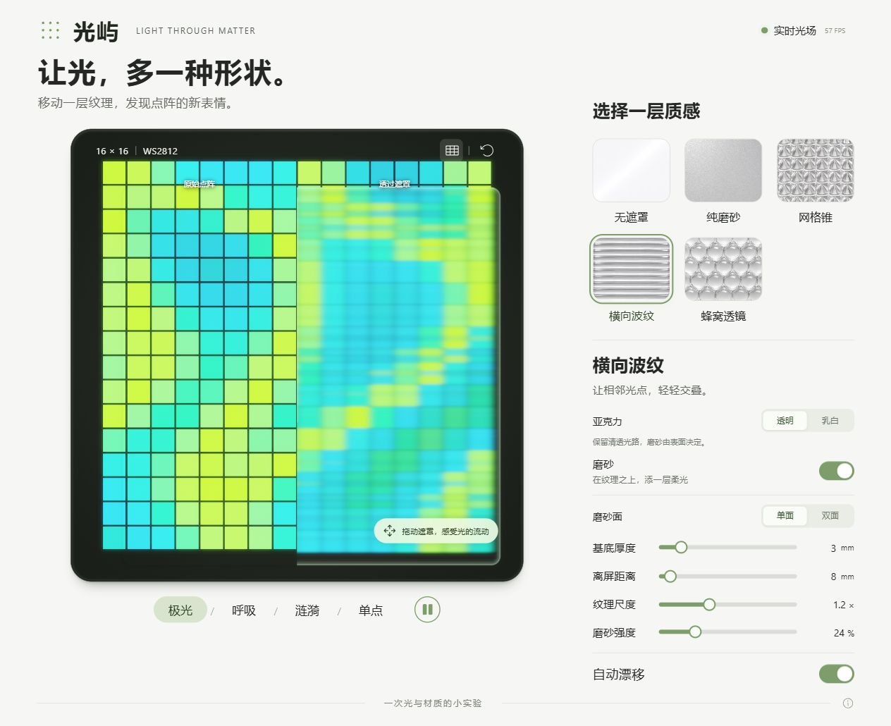
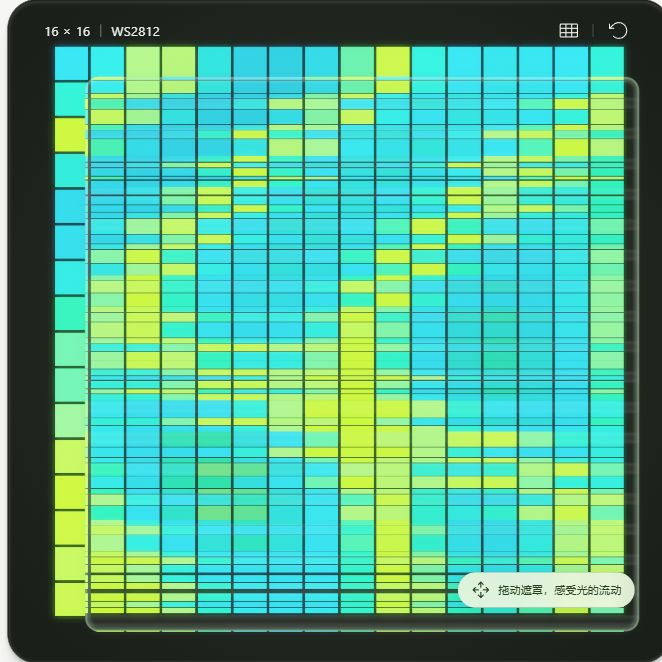
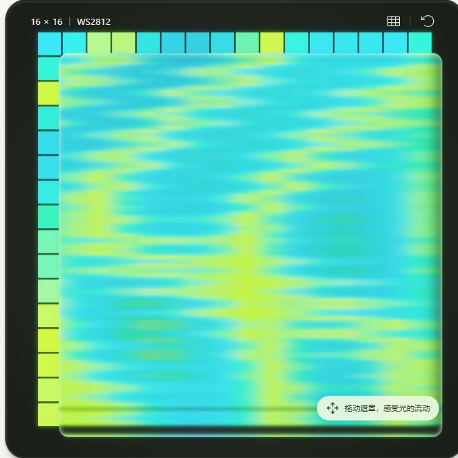
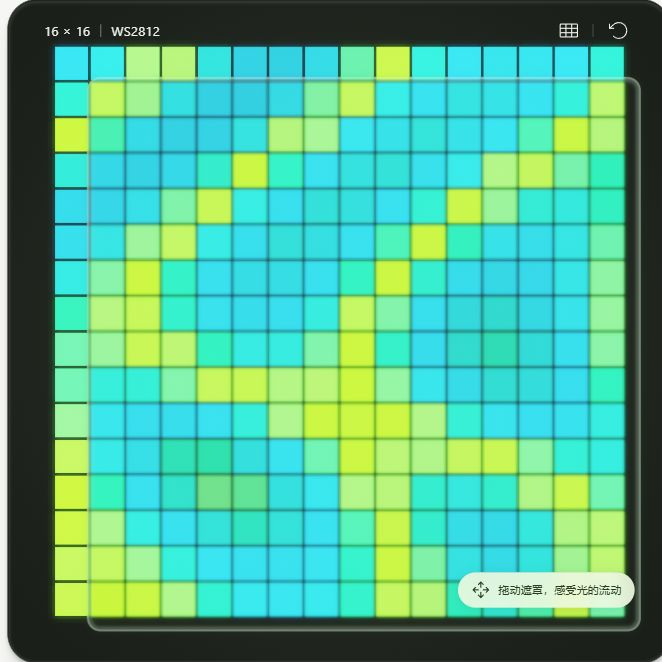
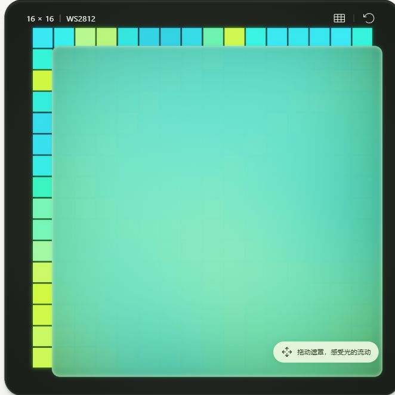

# 光屿 · Light Islet

**让光，多一种形状。**

光屿是一个在浏览器里运行的实时光学实验台。在 **16 × 16 的方形 LED 点阵**上方放一块亚克力罩片，拖动它，或者调一调纹理、厚度和离屏距离，看看清晰的方格怎样被拉长、聚拢，最终混成一片柔光。

[获取离线版](./%E5%85%89%E5%B1%BF.html) · [快速开始](#快速开始) · [两组对照实验](#两组对照实验) · [光学模型](./docs/optics.md)



*实时预览截图。开启视窗右上角的「原始 / 遮罩对比」后，同一帧灯光左半直接可见，右半透过罩片。*

## 快速开始

**离线体验：**打开 [光屿.html](./%E5%85%89%E5%B1%BF.html) 的 GitHub 文件页，点 **Download raw file**（下载原始文件），保存后用支持 **WebGL 2** 的浏览器打开。页面、渲染代码和材质缩略图都在这一个文件里。

**从源码运行：**需要 Node.js 22.12 或更高版本。

```sh
git clone https://github.com/juning98/light-islet.git
cd light-islet
npm ci
npm run dev -- --host 127.0.0.1
```

打开 Vite 输出的本地地址。选一种纹理，在光场里拖动罩片；也可聚焦光场后用方向键微调，按住 `Shift` 加快移动，按 `Home` 复位位置。底栏可切换 **极光、呼吸、涟漪、单点**。暂停灯光后仍可拖动罩片，也可单独开关自动漂移。

## 两组对照实验

先暂停灯光并关掉自动漂移，固定光源和罩片位置。下图截取自同一帧极光；每组只改动一个设置。

### 1. 给波纹加一层磨砂

选择**横向波纹**，使用 3 mm 透明亚克力，纹理 1.2×，离屏 24 mm。左图关闭表面磨砂，方形发光面被纹理拉出清晰的条带；右图开启单面磨砂（24%），条带边缘和相邻颜色开始交融，波纹的走向仍然可辨。

<p>
  
  
</p>

### 2. 把磨砂板从 0 mm 拉到 200 mm

选择**纯磨砂**，保持 3 mm 透明亚克力与 24% 单面磨砂。左图离屏 **0 mm**，紧贴灯面，仍能辨认方格；右图离屏 **200 mm**，更宽的扩散范围把相邻发光面混在一起，罩片上的光更均匀，亮峰也降低。

<p>
  
  
</p>

还可以切回**横向波纹**，关掉磨砂，在「透明」和「乳白」之间切换。乳白罩片即使没有表面磨砂，也会在内部混光；加厚它，可以观察直透光进一步减弱。

## 可以调什么

| 罩片 | 可以观察到什么 |
| --- | --- |
| 无遮罩 | 观察原始方形发光面，以及横竖连通的细缝。 |
| 纯磨砂 | 用均匀的雾面比较不同距离下的扩散，磨砂固定开启。 |
| 网格锥 | 方形锥面的棱面把光折向不同方向。 |
| 横向波纹 | 平行曲面拉伸光的轮廓，形成交叠的条带。 |
| 蜂窝透镜 | 六角透镜阵列汇聚并放大局部光场。 |

三种结构罩片各自记住磨砂开关；切换磨砂会保留纹理形状。亚克力可独立选择透明或乳白，基底厚度为 **0.5–20 mm**。离屏距离为 **0–200 mm**，量的是灯面到罩片底面之间的空气间隙；基底厚度另计。这两项既可以拖动滑块，也可以直接输入。单面磨砂位于观察者一侧，双面再加上朝向 LED 的一面。

## 光是怎么算出来的

React 管理界面和交互，WebGL 2 实时绘制光场。渲染器按纹理表面的法线计算折射，对 256 个方形发光面做连续面积积分来模拟磨砂，并为乳白亚克力单独计算体散射。页面上的材质缩略图来自 Image Gen；上面的实验图是实际运行时截取的光场。

模型用 160 mm 名义面板宽度、10 mm 节距和 9.2 mm 发光面作为参考尺寸。材质系数也是用于比较趋势的预设。对照特定实物时，需要实测的点阵尺寸与罩片透射、散射数据。公式、代码入口和数值验证见 [光学模型与校验](./docs/optics.md)。

## 开发与构建

- [`src/App.jsx`](./src/App.jsx) 与 [`src/materials.js`](./src/materials.js)：实验台、操作面板与材质预设。
- [`src/optics/`](./src/optics/)：渲染管线、GLSL 着色器和有限光源积分。
- [`docs/visual-reference.png`](./docs/visual-reference.png) 与 [`docs/generated-assets/`](./docs/generated-assets/)：设计参考与材质缩略图的原图。

```sh
npm run test:optics                  # 校验光学积分和材料参数响应
npm run build                        # 生成构建产物
npm run test:sites                   # 验证静态资源、路由回退和构建目录
node scripts/export-standalone.mjs   # 构建后更新根目录的 光屿.html
```
